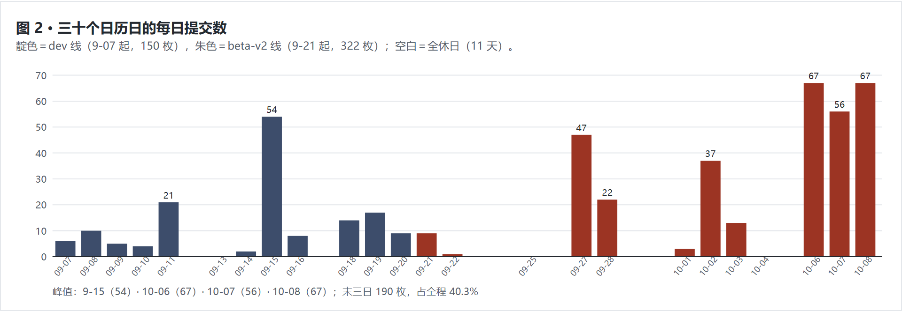
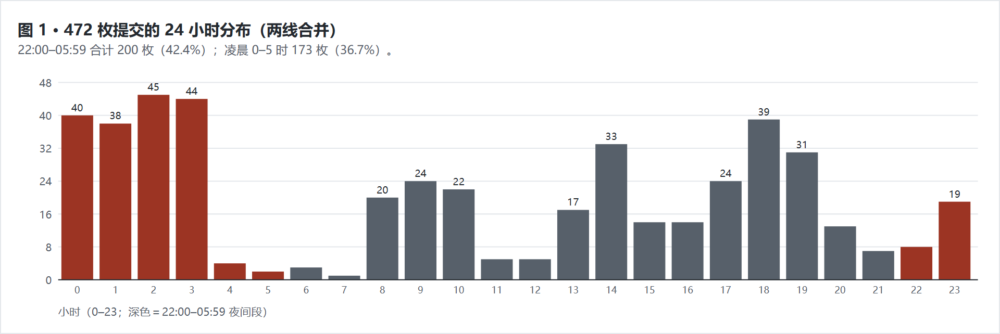
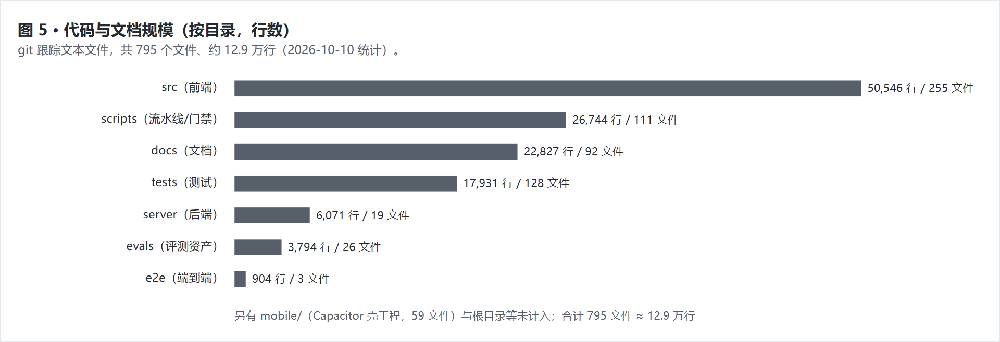
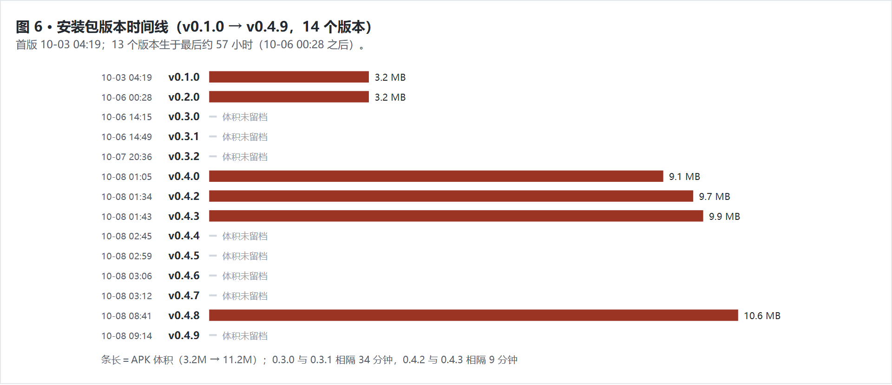
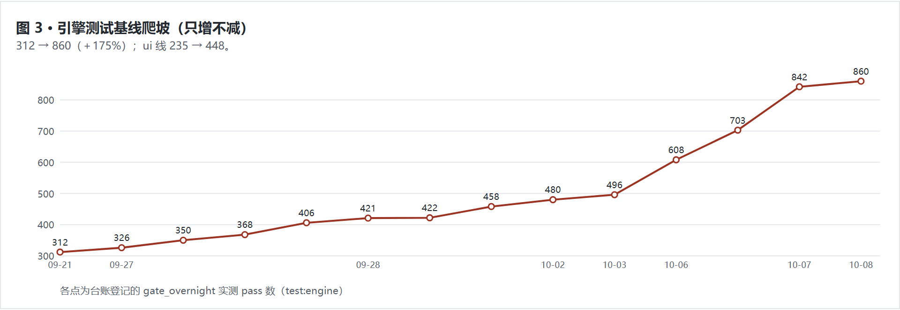
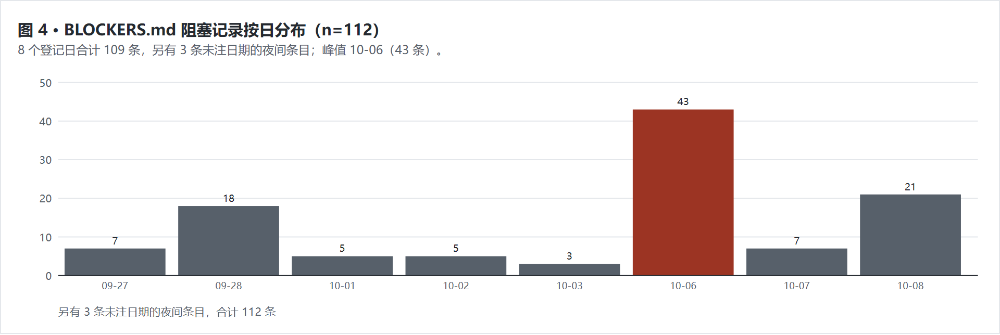

# 光溯 · 上理生活助手 —— 开发历程报告

> 统计区间：2026-09-07 16:24（首枚 commit）至 2026-10-08 09:14（末枚 commit）
> 编写日期：2026-10-11 · 数据全部来自仓库可复核记录，统计口径见附录 A
> 本报告为 Markdown 数据速查版；**网页版（Apple 风格单页）见 `docs/development-report-data-2026-10-11.html`**，**完整合并版（历程叙事 × 综合分析）见 `docs/development-report-full-2026-10-11.html`**，叙事海报版见 `docs/lightpath-chronicle-2026-10-11.html`，四者数据口径一致。

---

## 摘要

光溯（USST Lightpath）是第 18 届「光电杯」创新设计大赛参赛作品（决赛入围 10 组之一），定位为「懂上理、懂你、也懂分寸」的校园生活智能伙伴：校园知识问答（RAG）＋ 画像 ＋ 排程引擎 ＋ 移动端。30 日 17 小时内，两名学生与 AI 协作军团在两条 git 历史线上共完成 **472 枚 commit**、交付 **14 个安装包版本**、构建 **151 个测试文件 / 约 1,300 个用例**（引擎基线 312 → 860）、积累 **520 篇校园资讯 / 147 个地点** 数据资产，最终从 **112 组** 参赛作品中突围晋级决赛。

**关键数字一览**

| 指标 | 数值 | 说明 |
|---|---|---|
| 项目总时长 | 30 日 17 小时 | 首尾两枚 commit 之间；32 个日历日中 21 天有提交，11 天全休 |
| commit 总数 | 472 | dev 线 150 ＋ beta-v2 线 322 |
| 代码与文档规模 | ≈129,000 行 / 795 文件 | git 跟踪文本文件（2026-10-10 统计） |
| 测试规模 | 151 个测试文件 / ≈1,322 用例 | 另有 Playwright E2E 24 用例 |
| 安装包版本 | 14 个（v0.1.0 → v0.4.9） | 其中 13 个生于最后约 57 小时 |
| 数据资产 | 520 篇 / 1873 向量块 / 147 地点 | 17MB SQLite 库 ＋ 3 校区 OSM 路网 1,600+ 节点 |
| 深夜提交占比 | 42.4%（两线合并） | 22:00–05:59 共 200 枚；主线单独口径为 55% |
| 阻塞记录 | 112 条 | BLOCKERS.md，全部留痕可查 |
| 比赛结果 | 112 组中晋级决赛（十强第 7 席） | 初赛专家初评，2026-10 中上旬 |

---

## 1. 项目概况与定位演变

| 项 | 内容 |
|---|---|
| 项目名称 | 光溯 · 上理生活助手（usst-lightpath-planner，v0.4.9） |
| 参赛赛事 | 第 18 届光电杯创新设计大赛（光电学院学术部主办）· 主题「智逐光影，溯梦未来」 |
| 团队 | 2 人（CY 产品/数据/梨宝线；RAY 周排程算法/周视图）＋ AI 协作开发 |
| 技术栈 | TypeScript/React/Vite/Tailwind（前端）· Python FastAPI（后端 RAG）· SQLite（FTS5＋向量）· Capacitor/Android（移动端） |
| 部署形态 | 公网 Web（101.35.253.143，nginx＋systemd）· 签名 APK 直装 · ICS 订阅 · 云同步 |

项目经历三次定位演变（2026-09-15 定稿）：

| 版本 | 定位 | 转向原因（项目文档原文） |
|---|---|---|
| v1 | 反内卷排程工具（纯前端） | 把排程当主干，「留白率」为核心主张 |
| v2 | 梨宝校园 AI 助手（＋后端＋RAG） | 「贴心」本质是伙伴而非工具；规则引擎撑不起开放问答 |
| v3（终） | 懂上理的智能决策伙伴 | 排程只是一种输出形式；确立「懂上理 / 懂你 / 懂分寸」三钩子与 L1–L4 智能边界（L4 决策层绝不做） |

---

## 2. 时间投入分析

### 2.1 总体节奏

- 项目实际跨度 **30 日 17 小时**；21 天有提交（64%），11 天全休。
- 两条历史线：dev 线（09-07～09-20，脚手架至 PR #32 封笔）150 枚；beta-v2 线（09-21 快照起）322 枚。两线因三树合流与分支策略形成无共同祖先的双历史，直至 10-06 以「GitHub 默认分支切 beta-v2、dev 只读归档」销案。
- 提交最密集的末三日（10-06/07/08）共 190 枚，占全程 **40.3%**。

### 2.2 时段分布

472 枚提交的小时分布呈显著「夜战」特征：**22:00–05:59 共 200 枚（42.4%）**，其中凌晨 0–5 时 173 枚（36.7%）；主战役（9-27、10-06、10-08）均为通宵批次。主力线 beta-v2 单独口径下深夜占比达 **55%（177/322）**。日间 14 时与 18–19 时存在两个次峰，对应白天批次与下班后的集中开发。

### 2.3 六个开发阶段

| 阶段 | 日期 | commits | 关键交付 | 质量基线变化 |
|---|---|---|---|---|
| 一 · 基建与数据 | 09-07～09-14 | 48（dev） | 脚手架、AGENTS.md 协作军法、RAG 后端、数据 255→313 篇、空间图谱 v2 | golden 工具与验收框架搭设 |
| 二 · 定策与引擎 | 09-15～09-20 | 102（dev） | 定位三易其帜定稿、ADR-001~006、引擎 v2（两遍法/五算子）、防自欺六件套、变异/契约/a11y 测试设施、Ray 第四轮 UX 并入 | golden 首拍；P0/P1 验收 30 条 |
| 三 · 会师与整备 | 09-21～09-26 | 10（beta-v2） | 三树合流（304/330/1559 文件）、全仓 LF 军规、夜行军四批、语言规范 | engine 312→326 |
| 四 · 主战役 | 09-27～09-28 | 69 | 批 0-6＋V/S/T/D 批：追问状态机、理解端点、对话管理器、金标 60→100、E 批三库一画像接线、E2E 42→77 断言 | engine 326→458，ui 237→319 |
| 五 · 深化与移动端 | 10-01～10-05 | 53 | G 批三开关全开、H 批真机剧本 19/0、移动端一夜上线（APK 0.1.0 上公网）、习惯库扩域 | engine 458→496，ui 319→413 |
| 六 · 收官 | 10-06～10-08 | 190 | 三方会话协同、方法库 160 条入库、定鼎 beta-v2、UI v2 全站改版、Ray 五批会师、课表解析、云同步双向、95 枚 push、v0.4.9 | engine 496→860，ui 413→448 |

### 2.4 深夜提交明细

| 统计口径 | 数值 |
|---|---|
| 两线合并 22:00–05:59 | 200 / 472（42.4%） |
| 两线合并 00:00–05:59 | 173 / 472（36.7%） |
| beta-v2 线 22:00–05:59 | 177 / 322（55.0%） |
| 单小时峰值 | 10-08 00 时 20 枚；10-06 03 时与 10-07 14 时各 15 枚 |

---

## 3. 代码规模分析

git 跟踪文本文件共 **795 个、约 129,000 行**（不含 node_modules/dist；二进制数据文件另计）。语言构成：TS 302、TSX 117、MD 112、PY 90、MJS 15 等。

| 目录 | 行数 | 文件数 | 内容 |
|---|---|---|---|
| src | 50,546 | 255 | 前端（features 167 文件含 17 个子模块；lib/planner 引擎 35 文件 11,463 行；components 26 文件） |
| scripts | 26,744 | 111 | 数据流水线（61 个 Python 脚本 17,244 行）、门禁与验收工具（12 个 mjs 2,957 行）、37 个测试 |
| docs | 22,827 | 92 | 台账、战报、规格、验收报告等 87 篇 Markdown |
| tests | 17,931 | 128 | 引擎/UI/梨宝/移动端等测试 |
| server | 6,071 | 19 | FastAPI 后端（问答/检索/账号/同步/ICS/对话管理） |
| evals | 3,794 | 26 | 金标数据集与评测资产（214 条金标） |
| e2e | 904 | 3 | Playwright 端到端 |
| mobile | 59 文件 | — | Capacitor Android 壳工程（gradle/清单/签名） |

仅排程引擎（src/lib/planner）即 35 文件 11,463 行，含两遍法编排、增量滚动、锁定/涟漪、转场缓冲、知识库接线等模块。

**版本演进**：v0.1.0（10-03 首个 APK，3.2MB）→ v0.4.9（10-08，11.2MB），共 14 个版本；v0.4.0 起单版体积跳升至 9MB+（并入 Ray 周页整体架构）。

---

## 4. 质量保障体系

### 4.1 测试与门禁

| 项 | 数值 |
|---|---|
| 测试文件 | tests/ 114 个 ＋ scripts/ 内 37 个 ＝ 151 个 |
| 测试用例 | ≈1,322 个（另 E2E 24 用例） |
| 引擎基线爬坡 | 312（09-21）→ 860（10-08），11 天＋175%，全程「只增不减」纪律 |
| UI 基线爬坡 | 235 → 448 |
| 金标数据集 | 214 条（理解金标 111 ＋ 周级金标 5 份快照 ＋ 私有金标 16 ＋ 问答 42/45） |
| 能力地图 | 机器生成的「功能 ↔ 守护测试」映射（10-08 口径：148 测试守护 141 源文件、88 个反向验证锚点） |

测试纪律（写入 AGENTS.md 与各期任务书，机器强制）：

- **基线只增不减**：pass 数低于基线即红灯，视为删除/跳过测试。
- **反向验证**：新断言必须先红后绿（关掉实现要变红），禁止改断言凑绿。
- **金标只增不改**：期望值手算自规约，「禁止跑一遍实现抄输出（防循环论证）」。
- **虎符机制**：门禁脚本 md5 指纹登记，防夜间篡改门禁假绿。
- **开工/收尾双闸**：`preflight.mjs`（工作树/共同祖先/落后/脏区四查）与 `impact.mjs`（改动反查守护测试），另有 `gate_overnight.mjs` 全量门禁；自研门禁/审计脚本约 7,000 行（25 个）。

### 4.2 评测结果（活 LLM 实测）

| 评测 | 结果 | 出处 |
|---|---|---|
| 理解端点在线评测（60 条） | action F1 = 1.0（TP30/FP0/FN0），逐槽 EM 0.923 | docs/eval-libao-understand-2026-09-27.md |
| dialog 场景复评（40 条） | 宏 F1 0.972 / acc 0.975 / 拦截率 1.0 | 台账 §D 白天终验 |
| 七条真机剧本（live LLM） | 19 过 / 0 挂 | 台账 §H（2026-10-02） |
| 「出去玩 1 小时」全链 | 6/0（含 Ctrl+Z 撤销验证） | 台账 §D 终验 |
| 方法库检索 | 金标 126 条：recall 1.0 / MRR 0.777 / 拒答 1.0 / 伪科学拦截 1.0 | method-kb-acceptance-report-2026-10-06.md |
| 变异测试抽样 | SOFT_BUFFER_MIN 5→6 被 0 铃精确捕获（startMin 776→775） | scheduler-v2-spec §13.10 |
| 真实对话回归 | test:libao 45 轮双判据；eval:libao 9 维度 25 项 | AGENTS.md |

### 4.3 阻塞与事故管理

全程 **112 条阻塞记录**（BLOCKERS.md，8 个登记日），峰值 10-06 单日 43 条。记录即纪律：无法当场决定的事项一律停手登记交人拍板，不「猜一个合理值继续推」。

五起代表性事故（均有留痕与修复记录）：

| 事故 | 日期 | 根因 | 处置 |
|---|---|---|---|
| CRLF 行尾虚增 diff | 09-21 | 两树行尾形制不一，6 个数据文件被判整文件重写（虚增 ≈5.2 万行） | 全仓 LF＋.gitattributes 钉死 |
| UNRELATED_HISTORIES | 09-21 起至 10-06 | beta-v2 与 origin/dev 零共同祖先，agent 拉取只见旧历史 | preflight 机器闸拦截；10-06 13:20 拍板切默认分支销案 |
| 三方会话同树冲突 | 10-06 | 三个无人值守会话同一工作树并行 | mtime 取证＋车道划分（文件所有权零交集、显式路径 add），零覆盖 |
| 部署误删 dist | 10-06 10:41 | 管道命令置空线上 dist，抢修时 rm -rf 误删备份 | 三份 sha256 一致备份恢复（404 约 4 分钟）；次日上线每日 04:17 快照 |
| 图标 v24 暗堡 | 10-08 | Capacitor 模板 drawable-v24 变体在 API≥24 恒优先 | aapt2 拆包定位后修复（此前两轮修复均未触及） |

---

## 5. 数据工程

| 资产 | 数值 | 备注 |
|---|---|---|
| 校园资讯主条目 | 520 篇（515 篇入全文检索） | 公众号＋官网权威源；搜狗 token 过期致 57 篇缺全文（遗留） |
| 向量块 | 1,873 | bge-small-zh-v1.5，CPU 端 fastembed |
| 校园地点 | 147（26 POI ＋ 121 landmark） | 定位成功 143/147；基础学院 4 处路网未收录，如实不吸附 |
| 路网 | 3 校区 OSM，1,600+ 节点 | 军工路主校区 1,07 具名建筑、1,269 节点/1,433 路段 |
| 方法库/习惯库 | 160 条 | 金标 126 条评测（见 §4.2）；价值观终审全过 |
| 数据库 | usst_articles.db 17MB | 数据流水线五步（采集/抓全文/清洗/去重/建索引）可独立重跑 |

数据采集分四批完成（09-08 三连发＋后续补采）：255 → 308（公众号 53 篇）→ 313（三缺口）→ 515（官网权威源 20+ 站点，23 分钟 246 条，去重后净增 202）→ 520（收口）。校历 OCR 条目曾致「8 月底开学」错答，重写 1,368 字结构化文本后精确答出「9 月 7 日」。

---

## 6. 功能交付清单

**三端交付**：Web 总览/周计划/月历/画像/梨宝对话 · 安卓 APK（v0.4.9，签名分发）· 云同步（账号/待办/目标/计划，LWW 冲突裁决 ＋ ICS 订阅）。

核心功能与对应验证（均带机器守护）：

| 功能 | 说明 | 验证 |
|---|---|---|
| 排程真引擎 | 两遍法编排、增量滚动、锁定/涟漪、转场缓冲、六模式 | engine 860 用例 ＋ 5 份周级 golden 快照 |
| 梨宝对话 | 追问状态机＋对话管理器＋8 执行器；LLM 先行、规则兜底 | 金标 111 条双通道；45 轮回归 |
| 校园问答 | 520 篇 RAG ＋ 分层记忆 ＋ 相关性门 | 路由测试 44/44；隐私/事实错误修复留痕 |
| 画像 | 30 题分层问卷 → 规则映射 → 块级偏好入引擎 | L1–L4 边界，画像解释「这是我猜的，可改」 |
| 移动端 | 今日页/周板/梨宝全屏/常驻通知/执行力评估五维 | mobile 测试 7 文件 ＋ E2E 冒烟 18 用例 |
| 云同步 | 账号/待办/目标/计划，LWW＋契约 schemaVer=2 | syncContract 契约测试；双向补洞（v0.4.5） |
| 课表解析 | PDF/图片 → 19 条日程整链 | 公网实测 [] → POST 19 条 |
| 台账与守护 | capability map 机器生成「功能↔测试」映射 | --check 进门禁，删测试即红 |

开发批次：台账（wp-ledger-v2.md）登记 **35+ 个批次**（夜班 0-6、白天 A/B/C、V0-V3、S/T/D/E/G/H、M1-M5、收官 Wave/P 系、Ray 接入五批等），每批登记 commit、门禁实测值与偏差申报。

---

## 7. 协作与工程过程

**双人协作**：所有权表分工（CY：画像/梨宝/后端/数据/文档；RAY：周排程/引擎/组件），接壤处仅一个冻结接口（features/libao ↔ lib/planner）；RAY 两度以独立分支交付（09-20 第四轮 UX、10-08 五批），合并口径为「底层与实现逻辑以 Ray 的提交为准」。10-02 起项目转单人主导（RAY 名下并入 CY）。

**人机协作（本项目显著特征）**：开发由「人类拍板 ＋ AI 军团执行 ＋ 独立验收（MOSS）」三层结构完成。人类负责所有需求歧义与契约拍板（BLOCKERS 中「需要人决定」事项逐条留痕）；AI 承担无人值守通宵批次（6+ 份夜战报告/日志存档）；验收角色独立于执行。为此建立的机器纪律包括：三道门禁、虎符指纹、先红后绿、金标只增不改、append-only 日志、「没有人在看着你」自欺防线。10-06 凌晨实现三方会话同树并行零互踩（车道划分协议）。

**AI 贡献占比说明**：commit 作者署名统一为「光溯开发组」，无法按作者精确拆分；从台账与 commit 内容判断，代码主要由 AI 会话在人类逐批授权与验收下产出（Ray 的周页/目标批为其本人提交后接入）。

---

## 8. 比赛结果

| 项 | 结果 |
|---|---|
| 初赛 | 2026-10 中上旬专家初评，**112 组参赛** |
| 名次 | **决赛入围（拟奖 10 组），光溯列第 7 席** |
| 全场分布 | 三等奖 70 组 · 二等奖 25 组 · 决赛入围 10 组 · 余 7 组不授奖 |
| 决赛 | 2026-10 下旬现场答辩（PPT ＋ 演示），待进行 |

决赛备战状态：演示账号（gigity）全要素播种并实测剧本命中；v0.4.9 为演示版本；95 枚 commit 已推 GitHub 实现「远端与线上一致」。风险：服务器租约 10-25 12:17 到期，早于决赛。

---

## 9. 遗留事项（截至 10-11）

| # | 事项 | 影响 | 状态 |
|---|---|---|---|
| 1 | 服务器 10-25 到期 | 决赛前服务中断风险 | 仅 CY 可续，未办 |
| 2 | 决赛材料（申报书/PPT/视频） | 决赛必需 | 未启动 |
| 3 | 57 篇公众号缺全文 | 检索覆盖 | 待跑 fulltext.py 补抓 |
| 4 | 生活服务类数据偏薄 | 问答覆盖 | 待补采 |
| 5 | 基础学院 4 处定位未收录 | 空间问答 | OSM 无数据，如实标注 |
| 6 | lightpath.db 历史副本含敏感数据 | 推远端前需 filter-repo | 已登记，决赛 push 前处理 |

---

## 附录 A · 数据口径

1. **commit 计数**：`git rev-list --count` 分别计 origin/dev（150）与本地 beta-v2（322）；Ray 五批经 merge 已含于 322。
2. **行数/文件数**：`git ls-files` 按文本扩展名过滤后 `wc -l` 汇总（2026-10-10），不含 node_modules/dist/二进制；data/ 下 17MB SQLite 库为二进制不计行数。
3. **时段/每日分布**：`git log --date=format` 逐枚统计（含合并提交）；时区为 +0800。
4. **测试基线各点**：docs/wp-ledger-v2.md 各批次登记的 gate_overnight 实测值；「≈1,322 用例」为 `grep it/test(` 近似。
5. **BLOCKERS 计数**：BLOCKERS.md 条目（8 个登记日 109 条 ＋ 3 条未注日期夜间条目）。
6. **比赛结果**：112 组总数、十强名次、奖项分布出自队内留存放榜名册四纸（仓库内无记录）；赛事时间线出自知识库收录的官方通知（data/usst_articles.json）。
7. **评测数字**：均出自 docs/ 下对应评测/验收报告原文，未重新实测。
8. 本报告与 `docs/lightpath-chronicle-2026-10-11.html`（纪实小说版）、`docs/wp-ledger-v2.md`（批次台账）、`BLOCKERS.md`（112 条）构成互证。
